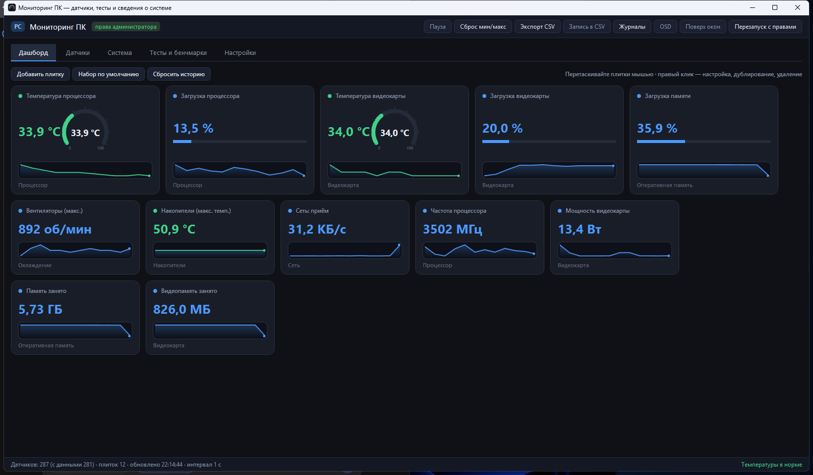
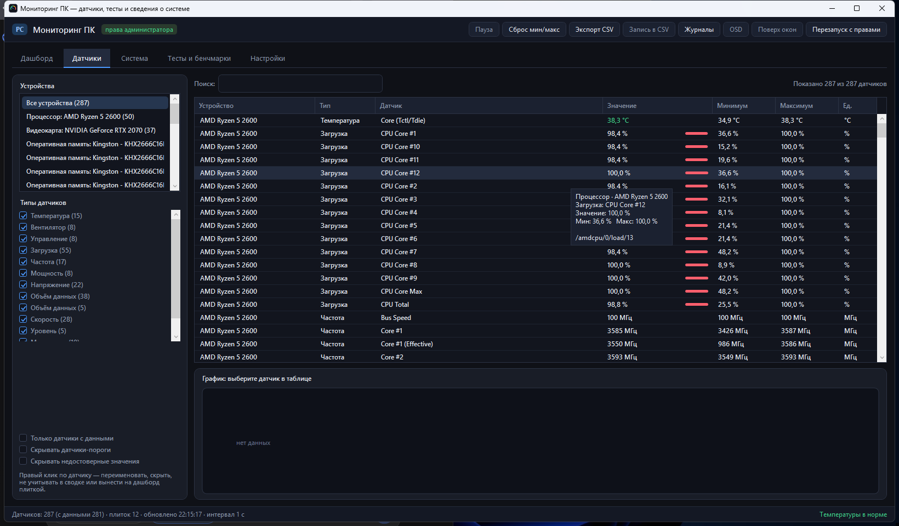
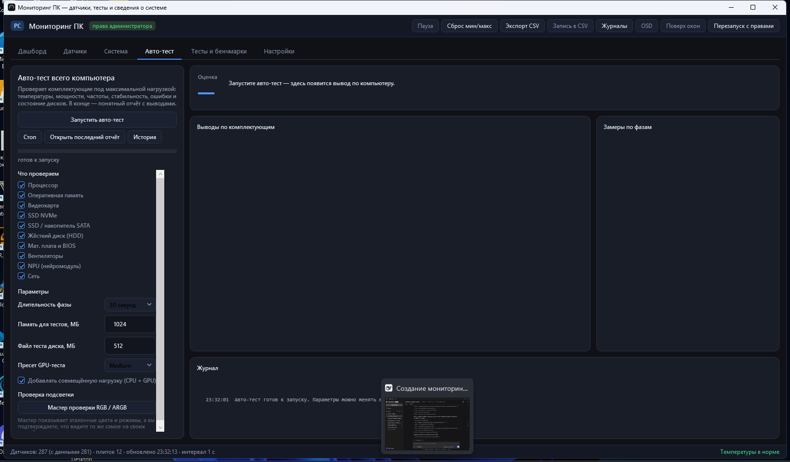
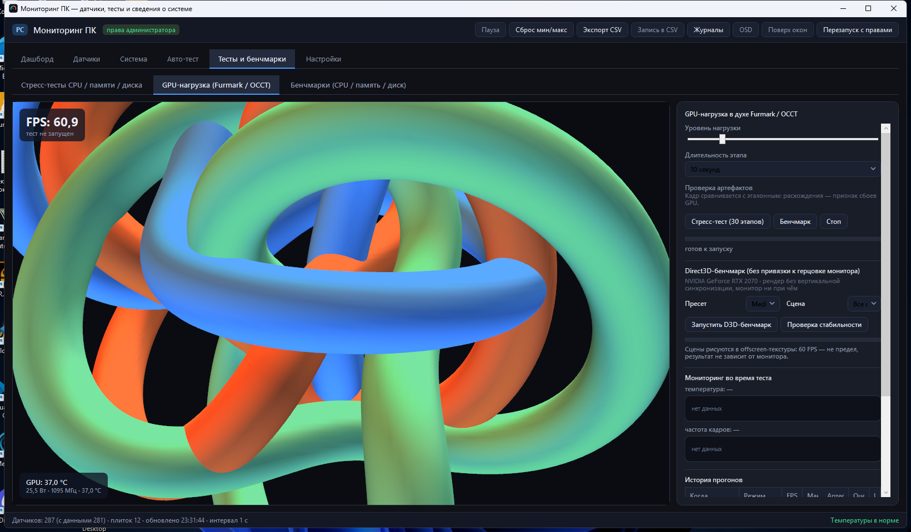
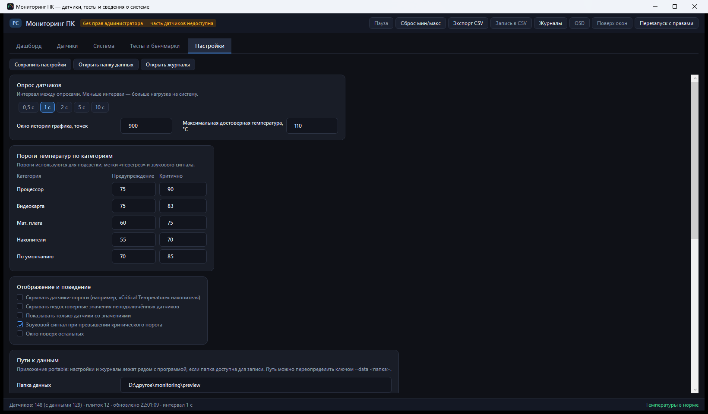
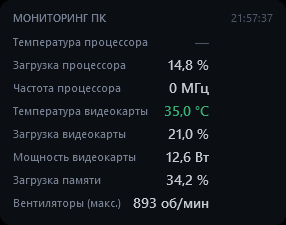
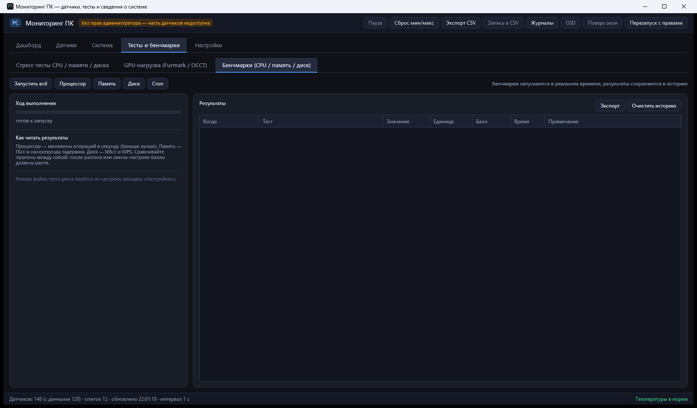
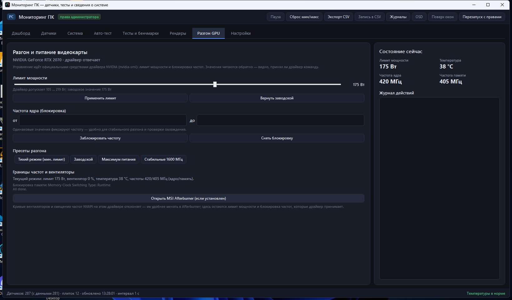
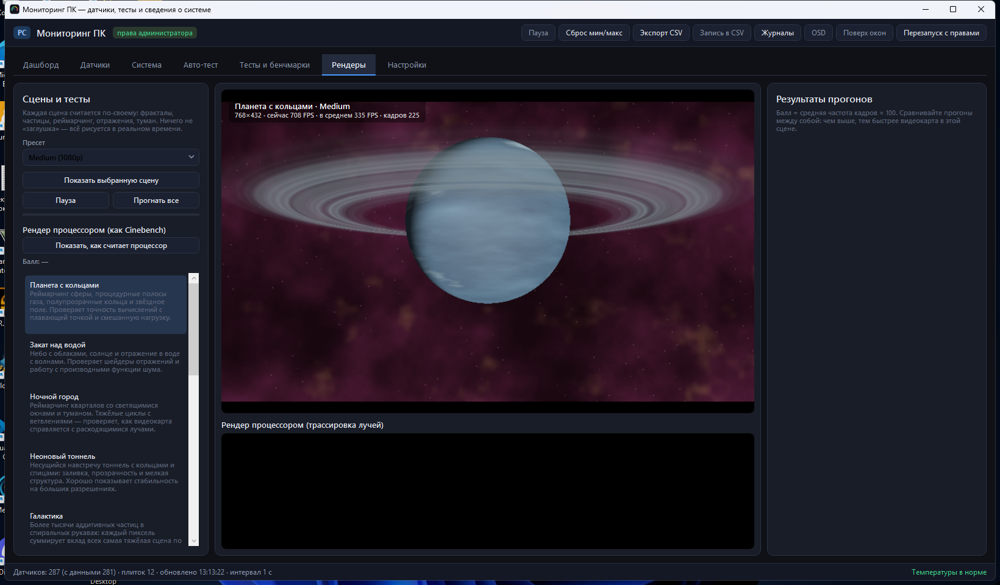

# Мониторинг ПК

Нативное приложение для Windows: **все датчики компьютера**, настраиваемый дашборд из плиток,
сведения о железе и BIOS, экранный оверлей, **авто-тест всего компьютера с выводами**,
GPU-тесты на Direct3D 11 (без привязки к герцовке монитора), бенчмарки в духе Cinebench /
Direct3D, стресс-тесты памяти и процессора с подсчётом ошибок.

Основа — [LibreHardwareMonitor](https://github.com/LibreHardwareMonitor/LibreHardwareMonitor) 0.9.6
(доступ к датчикам через kernel-драйвер **PawnIO**), интерфейс — WPF, Direct3D 11, .NET 10.

| Дашборд | Датчики |
|---|---|
|  |  |

| Авто-тест компьютера | GPU-тесты на Direct3D |
|---|---|
|  |  |

| Настройки | Экранный оверлей |
|---|---|
|  |  |

| Бенчмарки процессора, памяти и диска | Разгон GPU |
|---|---|
|  |  |

| Рендеры: живые сцены Direct3D и рендер процессором |
|---|
|  |

## Вкладки

### Дашборд — плитки датчиков
* Плитки **перетаскиваются мышью**, порядок сохраняется; правый клик — настроить, дублировать,
  сбросить историю, удалить.
* Более 30 готовых метрик: температуры, загрузки, **обороты вентиляторов (об/мин)**,
  **частоты процессора и видеопамяти (МГц)**, **сеть (приём/отдача, скачано ГБ)**,
  **объёмы (ГБ/МБ)**, мощности (Вт), напряжения (В) — плюс любой отдельный датчик из таблицы.
* Вид плитки: крупное значение, круговая шкала, полоса заполнения, график истории.
* Своё название, размер, пороги предупреждения и «критично» — для каждой плитки.

### Датчики — полная таблица
* Поиск, сортировка, фильтры по устройству и типу, минимум/максимум, график истории.
* Правый клик по датчику: «не учитывать в сводке», «скрыть», «переименовать», «создать плитку».
* Понятные обозначения: `80,0 °C (порог)` — это настроенный порог накопителя, а не измерение;
  `112,0 °C (недостоверно)` — неподключённый термистор платы (отсекается настраиваемым пределом).

### Система — сведения об оборудовании
Компьютер и ОС, UEFI/Secure Boot, файл подкачки; плата и BIOS; процессор (сокет, кэш, вывод о работе
выше базовой частоты); модули памяти с заявленной и фактической частотой и выводом про XMP/DOCP;
**таблица таймингов SPD** (строки — тайминги, столбцы — модули); видеокарты, накопители с температурой,
тома, сеть. Кнопка «Скопировать» выгружает сведения целиком.

### Авто-тест — проверка всего компьютера
Полная автоматическая проверка: приложение само нагружает комплектующие, снимает минимум, среднее
и максимум по датчикам и выдаёт понятные выводы.

**Как проходит тест (8 фаз):**

| Фаза | Что происходит |
|---|---|
| Инвентаризация | определяется состав: процессор, модули памяти, накопители (NVMe / SATA / HDD), видеокарта, NPU, плата, вентиляторы, сеть |
| Простой | базовые температуры и обороты без нагрузки |
| Процессор | рендер-бенчмарк на все ядра: температура, частоты, потребление, поиск троттлинга |
| Память | тест памяти с проверкой данных: считаются реальные расхождения |
| Видеокарта | нагрузка Direct3D: поиск артефактов + измерение частоты кадров, hot spot, мощность |
| Накопители | последовательные и произвольные операции, температура, состояние дисков |
| Совмещённая нагрузка | процессор и видеокарта одновременно — самый тяжёлый тепловой режим |
| Остывание | контрольный замер после нагрузки |

**Что показывает:** по каждой фазе таблицу «датчик — минимум — среднее — максимум»
(температуры процессора и видеокарты, hot spot, обороты, частоты, мощности, напряжения +12/+5/+3,3 В,
скорости дисков, трафик сети), найденные ошибки и заметки.

**Выводы (что хорошо, а на что обратить внимание):** температура процессора под нагрузкой,
троттлинг, температура и hot spot видеокарты, разница ядро/hot spot, стабильность GPU (артефакты),
ошибки памяти, температуры и «здоровье» накопителей, реакция вентиляторов, напряжения блока питания,
версия BIOS, отсутствие NPU, качество продува корпуса. Итог — оценка от 0 до 100 и список рекомендаций.

**Можно проверять отдельные комплектующие** — галочками выбираются процессор, память, видеокарта,
SSD NVMe, SSD/накопитель SATA, HDD, мат. плата, вентиляторы, NPU, сеть. Отчёт сохраняется в
`reports/autotest-<дата>.html` (и `.txt`), история — в `history/autotests.json`.

**Проверка подсветки RGB / ARGB** — отдельный мастер: показывает эталонные цвета и режимы
(красный, зелёный, синий, белый, плавный переход, радуга, дыхание, мигание, выключено), а вы
отвечаете «совпадает / не совпадает / нет такого устройства» по каждому устройству
(память, вентиляторы, кулер, видеокарта, лента ARGB, периферия). Ответы собираются в отчёт
`reports/rgb-check-*.txt`.

### Рендеры — живые сцены Direct3D 11
Отдельная вкладка: одиннадцать **разных** сцен, каждая считается по-своему и рисуется в реальном
времени прямо в окне (частота кадров видна на экране) — ничего не «заглушка».

| Сцена | Что показывает и что проверяет |
|---|---|
| Планета с кольцами | реймарчинг сферы, полосы газа, полупрозрачные кольца, туманность и звёзды — точность вычислений с плавающей точкой |
| Закат над водой | небо с облаками, солнце и отражение в воде с волнами — шейдеры отражений |
| Ночной город | кварталы со светящимися окнами и туманом — тяжёлые циклы с ветвлениями |
| Неоновый тоннель | несущийся навстречу тоннель — заливка, прозрачность, мелкая структура |
| Галактика | более тысячи аддитивных частиц в спиральных рукавах — самая тяжёлая сцена по ALU |
| Фрактал (зум) | бесконечный зум множества Мандельброта — устойчивость на пределе точности |
| Фрактал (реймарчинг) | Mandelbulb — тяжёлые пиксельные вычисления |
| Частицы | десятки тысяч аналитических частиц с аддитивным смешиванием |
| Ландшафт | реймарчинг ландшафта с фрактальным шумом в несколько октав |
| Множество Жюлиа | до 900 итераций на пиксель |
| Постобработка | многопроходное размытие — пропускная способность памяти видеокарты |

* Пресеты **Low (720p) / Medium (1080p) / High (1440p) / Extreme (4K)**.
* Кнопка **«Прогнать все»** проверяет каждую сцену и выводит баллы (балл = средняя частота кадров × 100).
* **Рендер процессором** — тот же трассировщик лучей, что и в бенчмарке, но картинка считается на глазах:
  видно, как процессор «прорисовывает» изображение, рядом растёт балл.
* Рендер идёт **в offscreen-текстуры, swap chain не создаётся**, поэтому 60 FPS — не предел и результат
  не зависит от герцовки монитора. Сцены считаются, только пока вкладка открыта, и останавливаются при уходе.

### Разгон GPU — управление средствами драйвера
Управление идёт **официальными средствами драйвера NVIDIA** (nvidia-smi), а не догадками: каждое
изменение сразу перечитывается, поэтому видно, принял ли драйвер команду.

* **Лимит мощности** — ползунок в пределах, которые сообщает сам драйвер (на RTX 2070 это 105…219 Вт),
  кнопки «Применить», «Вернуть заводской» и пресеты: тихий режим, заводской, максимум питания.
  Проверено на этой машине: 175 Вт → 200 Вт применяется и подтверждается драйвером.
* **Блокировка частоты ядра** — «от … до … МГц»: одинаковые значения фиксируют частоту (например,
  1600 МГц) для стабильного разгона и проверки охлаждения; есть кнопка снятия блокировки.
  Проверено: драйвер отдаёт 1605 МГц при заданных 1600.
* Живое состояние: лимит мощности, температура, частоты ядра и памяти, обороты вентилятора,
  диапазон лимита и сведения о поддержке блокировки памяти.
* Журнал действий: что отправлено драйверу и что он ответил.
* Кривые вентиляторов и смещения частот NVAPI на этом драйвере отклоняет (код ошибки несовместимости
  структур) — приложение честно об этом сообщает и сообщает об ограничении драйвера без сторонних рекомендаций.

### Вентиляторы — прямое управление оборотами
Обороты задаются **напрямую через контроллер платы** (как в FanControl), а не «нагрузкой»:

* Список управляемых каналов с текущим режимом: на этой плате это **Nuvoton NCT6793D, 6 каналов**
  плюс **оба вентилятора видеокарты** — всего 8 управляемых каналов.
* Ползунок и кнопка «Задать» для каждого канала (0–100 %), «Авто» возвращает управление BIOS,
  пресеты «Все 30 / 50 / 70 / 100 %» и «Всё на авто».
* **Автоматическая кривая**: приложение само подстраивает обороты, удерживая заданную температуру
  процессора (цель и шаг настраиваются).
* Проверено на этой машине: команда 100 % подняла **Fan #1 с 677 до 1772 об/мин**, **Fan #2 с 795 до 1543**,
  а вентилятор видеокарты запустился с нуля до **3024 об/мин**.
* Есть и командная строка: `--fans`, `--fans --set 50`, `--fans --auto`.

### Подсветка RGB / ARGB — управление, а не «на глаз»
Приложение **само определяет, чем может управлять**, и действительно меняет цвета и режимы:

* Находит OpenRGB и при необходимости поднимает его сервер (порт 6742).
* На этой машине найдено два устройства: **ASUS ROG STRIX RTX 2070** (Direct, Off, Static, Breathing,
  Flashing, Spectrum Cycle) и **JGINYUE B350M-TI Internal USB Controller** — ARGB-контроллер платы
  (Direct, Off, Static, Breathing, Random, Wave, Rainbow).
* Задаёт цвет (в том числе «погасить») и включает любой доступный режим.
* Командная строка: `--rgb` (определить), `--rgb --start`, `--rgb --color FF0000`, `--rgb --off`.
* Мастер проверки устроен по шагам: сначала определяется, что подключено, затем каждое устройство
  проверяется отдельно белым цветом («изменилось ли что-то»), и только потом идёт тест цветов и режимов
  с вопросами «совпадает / не совпадает / нет устройства».

### Работа в трее и автозапуск
* Значок в области уведомлений с меню: открыть окно, Дашборд, Датчики, Авто-тест, Рендеры, Разгон GPU,
  Вентиляторы, экранный оверлей, выход. Двойной щелчок — показать окно.
* Настройки: сворачивать в трей, закрывать окно в трей, показывать подсказку, запускать при входе
  в Windows, запускать сразу свёрнутым.
* Автозапуск пишется в раздел Run текущего пользователя (права администратора не нужны), путь берётся
  у самой программы — после переноса папки автозапуск продолжает работать.
* Ключ `--tray` запускает приложение сразу в трее; его же использует автозапуск.

### Первый запуск на другом компьютере
`scripts\publish-portable.bat` собирает **автономную сборку**: среда .NET внутри папки, устанавливать
ничего не нужно. Скрипт дополнительно кладёт рядом `d3dcompiler_47.dll` (нужна для шейдеров Direct3D),
установщик драйвера датчиков `PawnIO_setup.exe` и памятку `ПЕРВЫЙ-ЗАПУСК.txt`. Папку можно перенести
на флешке на любой компьютер: настройки, журналы и отчёты лежат в подпапке `data` рядом с программой.

### Тесты и бенчмарки
* **Стресс-тесты CPU / памяти / кэша / диска** — 66 тестов по 30 этапов (память с проверкой ошибок данных:
  свой адрес, moving inversions, walking ones/zeros, случайные и шахматные шаблоны, bit fade,
  modulo 20, два буфера со сравнением; процессор: целочисленные, ветвления, FP, SIMD, хеши,
  сортировки, решето; кэш: шаги 64 Б … 32 МБ; диск с проверкой целостности).
  Ошибки считаются по-настоящему, есть журнал, отмена, история и экспорт.
* **GPU-нагрузка (расширенная GPU-нагрузка)** — трёхмерная сцена с десятками тысяч треугольников, счётчик FPS,
  температуры и мощности прямо на картинке.
* **Direct3D-бенчмарк (собственный Direct3D)** — отдельный движок Direct3D 11: сцены
  «Фрактал (реймарчинг)», «Частицы», «Ландшафт», «Множество Жюлиа» и «Постобработка (многопроходная)»,
  пресеты **Low (720p) / Medium (1080p) / High (1440p) / Extreme (4K)**. Рендер идёт
  **в offscreen-текстуры, swap chain не создаётся**, поэтому 60 FPS — не предел и результат
  **не зависит от герцовки монитора**. Есть проверка стабильности: эталонный кадр сравнивается
  с последующими, любое расхождение — признак сбоя видеокарты.
* **Бенчмарки процессора и памяти** — рендер-бенчмарк в духе Cinebench (балл за трассировку лучей,
  одно ядро и все ядра), пропускная способность памяти (ГБ/с) и задержка (нс).
* **Бенчмарки диска** — как CrystalDiskMark: последовательные МБ/с и случайные 4К IOPS,
  **без буферизации** (FILE_FLAG_NO_BUFFERING), то есть измеряется реальный накопитель, а не кэш ОС.

### Настройки
Интервал опроса, окно истории, пороги температур по категориям, предел достоверности,
скрытие пороговых и недостоверных датчиков, экранный оверлей (положение, прозрачность, кегль,
набор метрик), параметры тестов и **папки с данными**.

### Экранный оверлей (собственный оверлей)
Окно поверх всех приложений, **сквозное для кликов**, с выбранными метриками.
Включается кнопкой «OSD» или горячей клавишей **Ctrl+Alt+O**.

## Папки: приложение полностью переносимое

```
Мониторинг ПК\
  app\           готовая программа (PcMonitor.exe)
  docs\          скриншоты
  scripts\       build.bat, run.bat, publish-standalone.bat, diagnostics.bat
  src\PcMonitor\ исходники
  tools\         диагностика датчиков и проверки
  README.md
  datapath.txt   (необязательно) путь к папке данных на другом диске
```

Папку с программой можно **перенести на любой диск или флешку** — настройки, журналы, отчёты и
история поедут вместе с ней. Данные лежат рядом с программой:

```
app\data\
  settings.json     настройки
  logs\             журналы измерений (CSV)
  reports\          отчёты авто-тестов (HTML/TXT), бенчмарков, проверки подсветки
  history\          история прогонов (JSON)
  tests\            временные файлы тестов диска
  profiles\         профили и резервные копии настроек
```

Если папка программы недоступна для записи, данные автоматически переезжают в
`%LOCALAPPDATA%\PcMonitor\data`. Путь можно задать вручную:

* в настройках — кнопка «Изменить папку данных…» (файлы переносятся, приложение перезапускается);
* файлом `datapath.txt` рядом с программой (одна строка — путь);
* ключом командной строки `--data <папка>`.

## Командная строка

```text
PcMonitor.exe --autotest [--quick] [--seconds 30] [--components cpu,ram,gpu,storage]
                         [--memory 4096] [--disk-mb 1024] [--out report.txt]
        полный авто-тест компьютера с выводами и отчётом

PcMonitor.exe --dump [--seconds 5] [--out report.txt] [--json]
        отчёт по всем датчикам

PcMonitor.exe --gpu-bench --d3d [--preset low|medium|high|extreme] [--seconds 10]
                         [--out report.txt]
        GPU-бенчмарк Direct3D 11 (без привязки к герцовке монитора)

PcMonitor.exe --gpu-bench [--seconds 30] [--load 8]
        оконный GPU-тест с реальной GPU-нагрузкой с поиском артефактов

PcMonitor.exe --bench [--cpu] [--memory] [--disk] [--disk-mb 1024]
        бенчмарки процессора, памяти и диска

PcMonitor.exe --stress [--list] [--category Memory] [--id cache.stride-64b] [--count 3]
        стресс-тесты из каталога (66 тестов по 30 этапов)

PcMonitor.exe --data D:\MyData
        хранить настройки и журналы в указанной папке
```

## Требования

* Windows 10 / 11, 64-бит, видеокарта с поддержкой Direct3D 11 (иначе движок уйдёт на WARP).
* **Права администратора** — для температур процессора, напряжений и вентиляторов платы.
* Для запуска: .NET Desktop Runtime 10 (или автономная сборка); для сборки WPF из исходников — .NET SDK 10.
* Драйвер **PawnIO** — используется LibreHardwareMonitor. Проверка: `sc query PawnIO` → `RUNNING`.
* Для сборки из исходников — Rust stable для `x86_64-pc-windows-msvc` и Visual C++ Build Tools.

## Активность в Discord

Вкладка «Настройки» → «Активность в Discord»: включите отображение и вставьте **Application ID** приложения, созданного в Discord Developer Portal. Приложение должно быть запущено, а Discord Rich Presence — разрешён в настройках Discord. Если Discord закрыт или перезапускается, PcMonitor будет переподключаться автоматически; Application ID хранится в `data/settings.json`.

## Сборка и запуск

```text
scripts\build.bat               собрать в папку app\
scripts\build-rust-core.bat     собрать Rust monitor sidecar отдельно
scripts\run.bat                 собрать (если нужно) и запустить
scripts\publish-standalone.bat  автономная сборка (~180 МБ, .NET не нужен)
scripts\diagnostics.bat         перечислить все датчики, которые видит библиотека
```

Вручную:

```powershell
dotnet publish src\PcMonitor\PcMonitor.csproj -c Release -r win-x64 --self-contained false -o app
scripts\build-rust-core.bat
.\app\PcMonitor.exe
```

## Структура исходников

```text
src\PcMonitor\
  Core\
    Monitoring\   опрос датчиков, метрики, плитки, сводка
    Settings\     настройки и папки данных
    System\       сведения о железе (WMI, SMBIOS, SPD)
    Testing\      авто-тест, вердикты, бенчмарки, движок стресс-тестов (Testing\Stress)
    Gpu\          Direct3D 11: сцены, шейдеры, компилятор HLSL
    Reporting\    CSV и HTML-отчёты
    Cli\          режимы командной строки
  Controls\       график, круговая шкала, 3D-сцена
  Views\          Tabs\ (вкладки), Dialogs\ (диалоги и мастера), Overlays\ (оверлей)
  Themes\         тёмная тема
  Assets\         иконка
src-rust\pcmonitor-core\ Rust-ядро и системный мониторинг (этап 1)
tools\SensorProbe\  диагностика датчиков
tools\StressCheck\  проверка движка стресс-тестов
```

## Перенос на Rust — этап 1

`src-rust\pcmonitor-core` собирается как Rust monitor sidecar. Реальный WMI-инвентарь и показания CPU/RAM/дисков плюс сетевые счётчики Windows поступают в WPF по локальному JSONL-потоку. Температуры, напряжения, SPD, вентиляторы и управление ими пока остаются на LibreHardwareMonitor/PawnIO; неподдержанные показания не подменяются нулями. Сборка Rust отдельно: `scripts\build-rust-core.bat`; сборки `build.bat`, `publish-portable.bat` и `publish-standalone.bat` кладут sidecar рядом с `PcMonitor.exe`.

## Обновление интерфейса и нагрузки

В `outputs\PCMonitorPortable` собрана автономная версия со встроенным .NET. GPU-превью обновляется отдельно от измеряемого offscreen FPS; стресс-тест имеет 4K/32× режим. На RTX 2070 достигнуто 99 % загрузки за 60,02 с при 74,7 °C. Описание изменений, запуск и аппаратные ограничения — `outputs\UPGRADE.md`. Перед запуском завершите старую версию через меню в трее.

## Частые вопросы

**Мат. плата показывает 112 °C, хотя датчика нет.** Неподключённый термистор. Значения выше
«максимальной достоверной температуры» помечаются `(недостоверно)` и не влияют на сводку и тревоги.

**На SSD видно 80 °C и 40 °C.** 80 °C — настроенный порог накопителя («Warning Temperature»),
а не температура. Такие датчики помечаются `(порог)`; их можно скрыть в настройках.

**Авто-тест пишет «температура недоступна».** Запустите приложение от имени администратора:
без прав не читаются температуры процессора, платы и вентиляторы.

**Direct3D-бенчмарк показывает «программный рендер (WARP)».** Драйвер видеокарты не создал
аппаратное устройство D3D11 — обновите драйвер; тест всё равно работает, но медленно.

**Антивирус ругается на драйвер.** PawnIO — подписанный драйвер с открытым исходным кодом,
именно он даёт доступ к датчикам платы и процессора.


## Release от 16.11.2026

Обновлённая сжатая переносимая сборка: `outputs\PCMonitorPortable-Release\PcMonitor.exe` (папка содержит exe, Rust sidecar и D3D compiler). Превью рендеров работает отдельно от нагрузки; для перехода завершите старый экземпляр через трей и запустите новую версию. Полный список изменений и проверок — `outputs\UPGRADE.md`.
